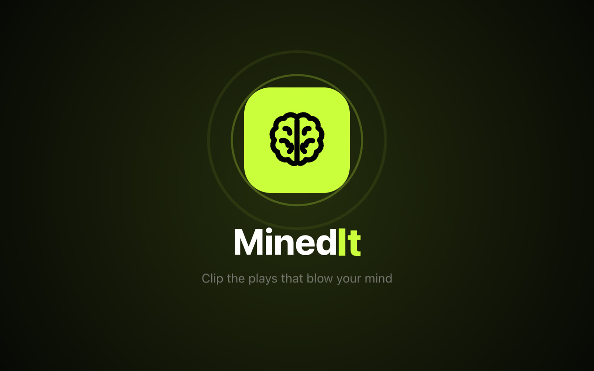
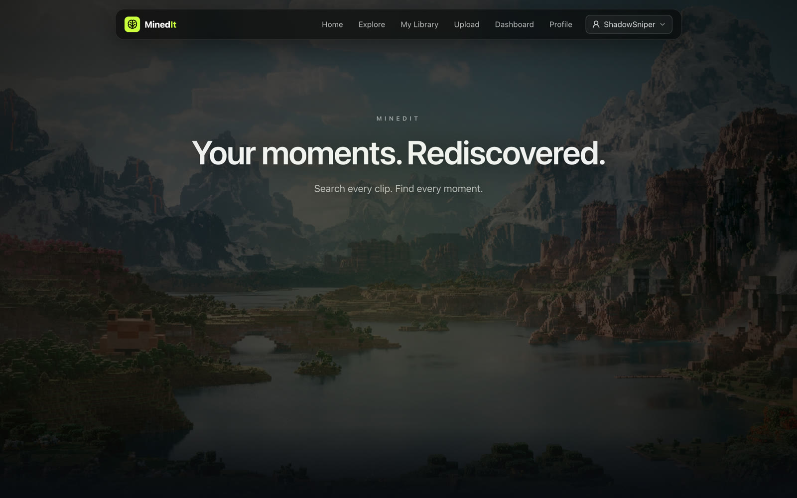
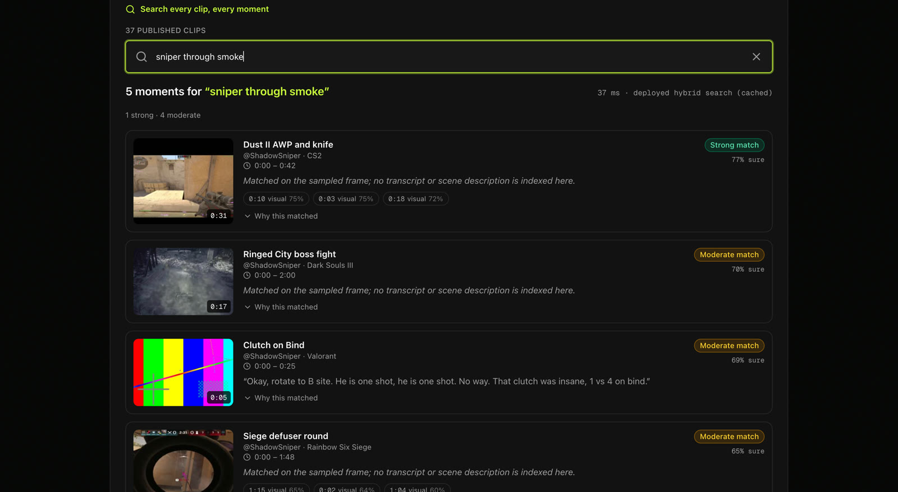
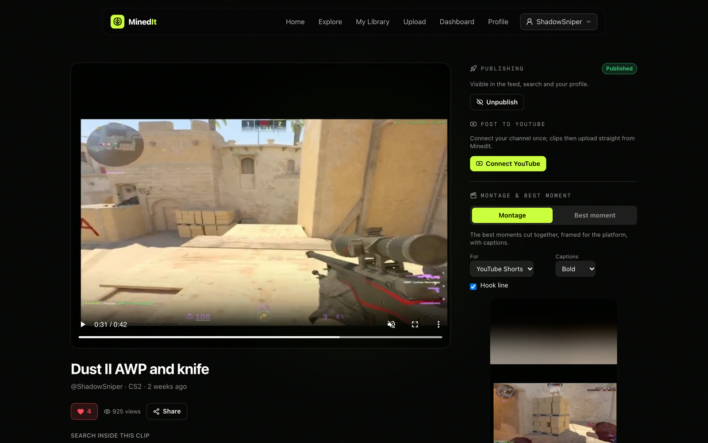
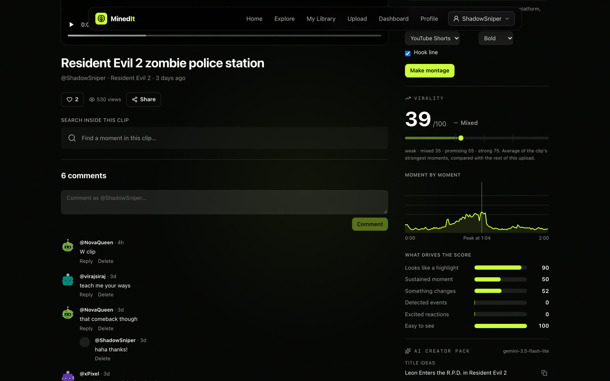
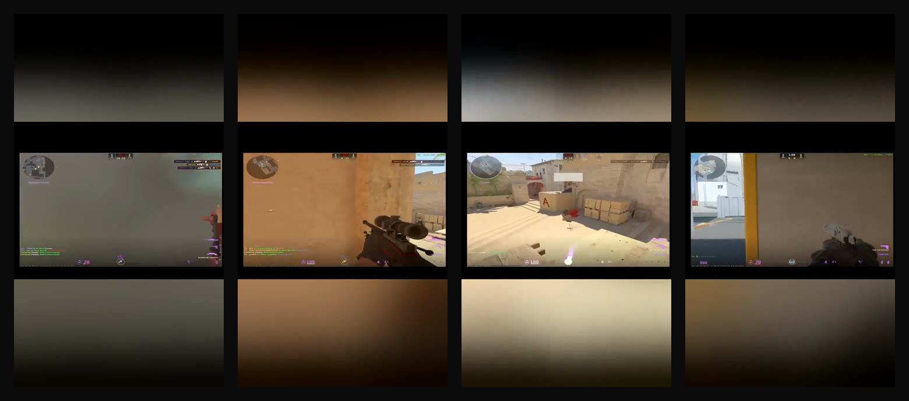
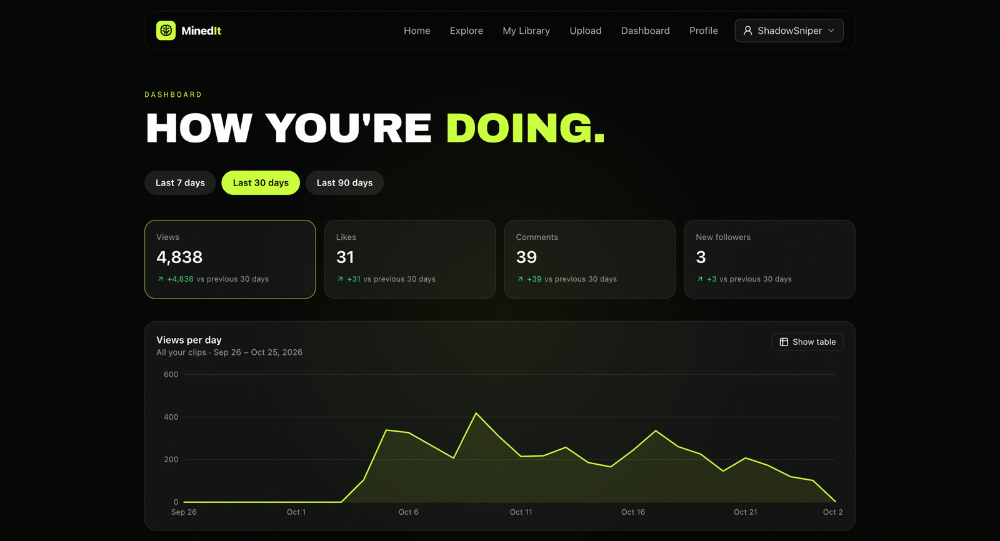
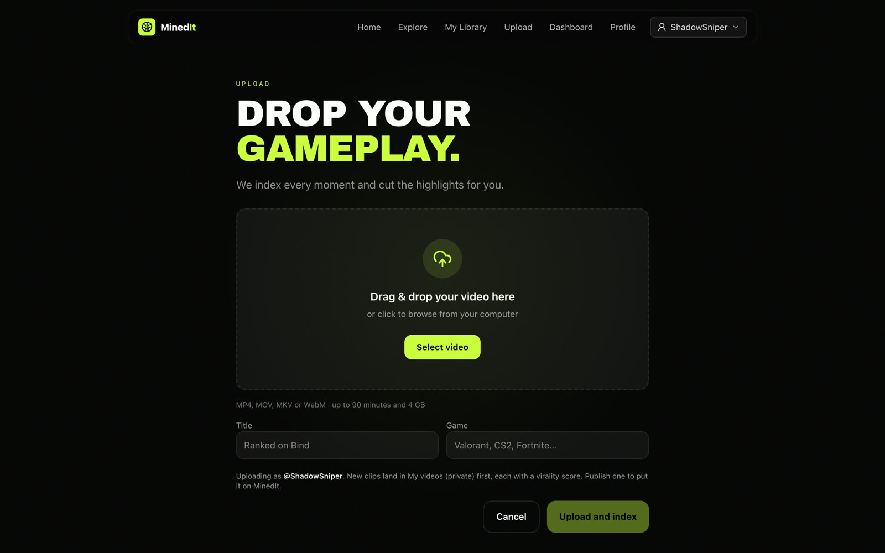
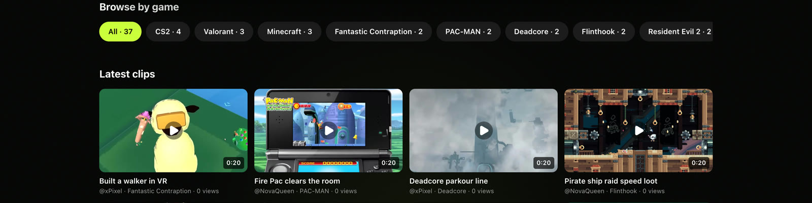

<p align="center">
  
</p>

<h1 align="center">MinedIt</h1>

<p align="center">
  <b>Your moments. Rediscovered.</b><br>
  Upload your gameplay, then search it the way you'd describe it: <i>"the clutch on Bind"</i>, <i>"sniper through smoke"</i>, <i>"when my friend screamed"</i>.<br>
  MinedIt jumps to the exact second, cuts the highlights, scores how viral they'll be and makes a vertical edit ready for Shorts.
</p>

<p align="center">
  <a href="https://minedtv.vercel.app"><b>Try it live →</b></a>
  &nbsp;·&nbsp; <a href="backend/README.md">Backend</a>
  &nbsp;·&nbsp; <a href="backend/docs/android-integration.md">API for apps</a>
  &nbsp;·&nbsp; <a href="https://github.com/rishikesh-web/MinedTv">Android app</a>
</p>

<p align="center">Built for the Medal.tv hackathon.</p>

<p align="center">
  
</p>

---

## Search every moment

Type what happened, not what the file was called. Every upload is indexed frame by frame (what it looks like), line by line (what was said) and event by event (kills, clutches, wins). Each result says how sure it is and why it matched, and plays from the exact second.

<p align="center">
  
</p>

Under the hood it's hybrid search: CLIP image embeddings for every sampled frame, Whisper transcripts searched semantically and by keyword, and detected highlight events, fused with reciprocal rank fusion and calibrated into a 0–1 confidence. Search also works on a screenshot, and inside a single clip.

## Your clip, everything around it

<p align="center">
  
</p>

- **Publish** when you're ready. Uploads land privately in *My videos*; publishing puts a clip in the feed, search and your profile.
- **Post to YouTube** straight from the page once your channel is connected, with the title, description and tags written for you.
- **Montage & best moment**: one click turns a clip into a 9:16 edit of its strongest moments (or just the single best one), framed for Shorts, TikTok or Reels, with burned-in captions and a hook line, and posts it to YouTube.
- **Likes, comments with replies, follows, share**, plus related clips from the same game.

## Know what will hit

<p align="center">
  
</p>

Every upload is scored moment by moment. Highlight clips are cut automatically at the peaks, and each clip gets a **virality score** with the curve and the signals behind it: does it look like a highlight, does the moment hold, does something change, were there events or excited reactions, is it easy to see. An **AI creator pack** (Gemini) adds title ideas, a caption, hashtags, YouTube metadata and key moments.

<p align="center">
  
  <br><sub>Frames from a real montage: a 42-second CS2 clip cut down to its best 13.5 seconds, reframed to 9:16.</sub>
</p>

## Watch your numbers

<p align="center">
  
</p>

Views (counted once per viewer), likes, comments and new followers per day over 7, 30 or 90 days, compared with the period before, and every clip with its virality score.

## Drop it in, we do the rest

<table>
  <tr>
    <td width="50%"></td>
    <td width="50%"></td>
  </tr>
  <tr>
    <td align="center"><sub>Upload: MP4, MOV, MKV or WebM, up to 90 minutes</sub></td>
    <td align="center"><sub>Explore: the latest clips, browsable by game</sub></td>
  </tr>
</table>

An upload goes straight from the browser to storage, then a worker probes it, cuts it into 2-second HLS segments, samples and embeds frames, transcribes the audio, checks it against the content policy (18+ gating, blocking severe content), scores every moment and cuts the highlight clips. Vertical phone recordings stay vertical end to end, and the API serves a separate **Reels** feed of short vertical clips for the Android app.

---

## How it's built

```
browser / Android ──▶ Next.js (Vercel) ──proxy, holds the API key──▶ FastAPI (Cloud Run)
                                                                       │
        R2 (video, HLS, thumbnails) ◀── presigned upload ──────────────┤
        Postgres + pgvector (Supabase) ◀── clips, frames, transcripts ─┤
        Redis (Upstash) ◀── job queue, counters, search cache ─────────┤
                                                                       ▼
                     RQ worker (Cloud Run Job) ── ffmpeg · CLIP + Whisper on Modal GPUs · Gemini
```

| | |
|---|---|
| **Web** | Next.js 16, React, Tailwind, Framer Motion · [`frontend/`](frontend/) |
| **API** | FastAPI, async SQLAlchemy, Alembic · [`backend/`](backend/) |
| **Search** | pgvector HNSW, CLIP embeddings, Whisper transcripts, Postgres full-text, reciprocal rank fusion |
| **Media** | ffmpeg: HLS segments, thumbnails, frame sampling, 9:16 montages with burned-in captions |
| **AI** | Modal T4 GPUs for CLIP and Whisper, Gemini for creator packs, captions and moderation, a frame-level virality scorer |
| **Infra** | Cloud Run, Supabase, Upstash, Cloudflare R2, Vercel |

Clips are **views**: a clip is just a time range over its upload's segments, so trimming or extending one is a PATCH, with nothing re-encoded.

## Run it locally

```bash
# Backend: Postgres, Redis, S3, migrations, API and worker (stub models, no GPU needed)
cd backend && docker-compose up -d --build
open http://localhost:8000/docs

# Web app
cd frontend && npm install && npm run dev
```

For the web app, copy `frontend/.env.example` to `frontend/.env.local` and fill in the API's address and key. See [`backend/README.md`](backend/README.md) for setup, demo data and plugging in real models.

**Deploys are automatic.** A push to `main` that touches `frontend/` deploys the web app; one that touches `backend/` runs the tests, migrates the database and rolls out the API and worker (GitHub Actions, keyless sign-in to Google Cloud).

## Team

| | |
|---|---|
| **Viraj** | Backend, infrastructure, search, web app |
| **Jasper** | Web frontend, search model quality |
| **Rishi** | Android app |
| **Nihal** | Creator AI, virality scoring, montages |

Who owns what and what's open: [NOTES.md](NOTES.md).
